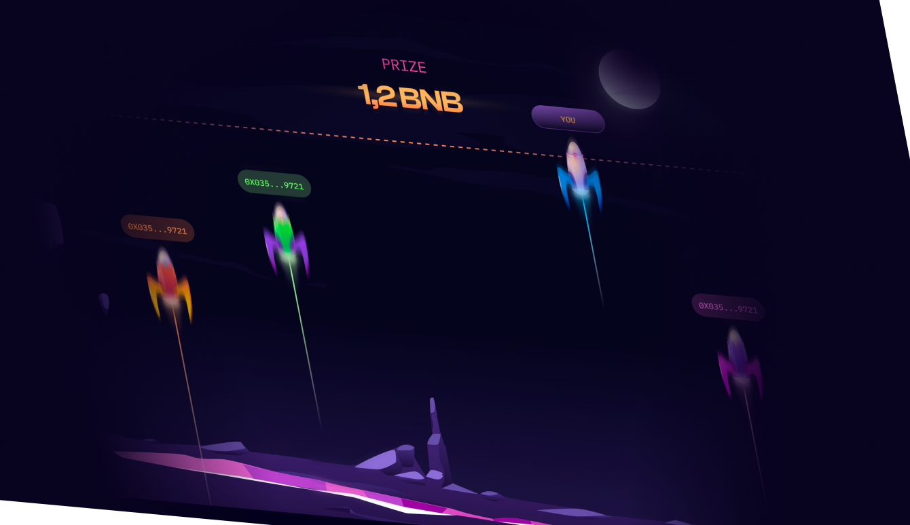

# Rocket Alion

> Multiplayer rocket race on BNB Smart Chain: players stake BNB, launch together, and the rockets that reach the finish line win the prize.



<h5 align="center">
  <a href="#how-it-works">How it works</a> ·
  <a href="#tech-stack">Tech stack</a> ·
  <a href="#project-structure">Project structure</a> ·
  <a href="#getting-started">Getting started</a>
</h5>

Frontend of a Web3 game built in 2022 (June to September, 115 commits). A player connects a wallet, picks a room with a fixed bet (Rookie, Bounty hunter, King), pays the bet in BNB, waits in a lobby until the room fills, then watches a race of four rockets. Rockets of winning players cross the finish line; the others explode. The game outcome comes from the backend; this app handles the wallet, payment, real-time lobby and the race animation.

## How it works

```
Wallet (MetaMask / WalletConnect)
        │  web3.js: accounts, balance, chain switch, sendTransaction
        ▼
  Vue 3 app ── POST /game/pay (axios) ──────────►  api.rocketalion.com
        ▲                                                │
        └──────────── socket.io (websocket) ◄────────────┘
              rooms, lobby players, results, stats
```

**Wallet connection** (`src/services/web3/wallet/`)

- Two providers registered in `providers.js`: injected MetaMask (`window.ethereum`) and `@walletconnect/web3-provider` with BSC RPC endpoints.
- `actions/connect.js` creates a `Web3` instance, reads the account, balance and chain id, and if the chain is not BSC mainnet (56) or testnet (97) calls `utils/setupNetwork.js` (`wallet_switchEthereumChain`, falling back to `wallet_addEthereumChain`).
- Subscribes to `accountsChanged`, `chainChanged` and `disconnect`. Wallet state lives in `useState.js` (a `shallowReactive` store persisted to `localStorage`) and is restored on reload by `actions/autoConnect.js`. On mobile inside the MetaMask in-app browser the wallet connects automatically.
- The router guards `/game` and `/history` behind a connected wallet.

**Paying for a game** (`src/services/playground/game.js`)

1. Room data (bet, prize, winning chance, capacity, game wallet address, `paid` flag) is requested over the socket and kept in the `rooms` Pinia store.
2. `actions/sendTokens.js` sends the bet in BNB to the room's game wallet with `web3.eth.sendTransaction`.
3. After confirmation the transaction hash is posted to `POST /game/pay` for server-side verification.
4. On success the client subscribes to the `game` socket scope and moves to the lobby. If the room is already paid, the client skips payment and rejoins.

**Real-time layer** (`src/api/realtime/`)

- `realtime.js` opens one socket.io connection (websocket transport) tagged with a per-tab client id from `sessionStorage`, and exposes three helpers: subscribe to a scope, unsubscribe, and a request/response call over the socket.
- Scopes used: `gameType` (rooms), `game` (lobby players and results), `recentWinnings` (live feed), `playerStats` and `playerStatsCount` (history page).
- The active game is mirrored to `localStorage` (`services/playground/storage.js`), so a player who reloads or drops offline is reconnected to the same game or shown its result.

**Race animation** (`src/components/game/playground/`)

- `GameView.vue` switches between three stages: lobby, visual, results, driven by the `game` store.
- `services/playground/rocket.js` animates each rocket with `requestAnimationFrame` and `translate3d`; losing rockets get a shorter flight and an explosion sprite, winners reach the finish line. Trails are SVG gradients (`RocketTrail.js`).

## Tech stack

| Area | Tools |
|---|---|
| UI | Vue 3 (`<script setup>`), Vue Router 4, SCSS modules |
| State | Pinia, Vue reactivity, `localStorage` / `sessionStorage` |
| Web3 | web3.js 1.7, MetaMask, WalletConnect v1 |
| Chain | BNB Smart Chain (mainnet 56, testnet 97) |
| Real-time | socket.io-client 4 |
| HTTP | axios |
| Build | Vite 2, vite-svg-loader, ESLint, Prettier |

## Project structure

```
src/
├── api/realtime/        socket.io client, scoped subscriptions, rooms/stats/game/winnings
├── components/
│   ├── game/            room cards, payment popup, history, playground (lobby, race, results)
│   ├── wallet/          wallet connect button and popup
│   ├── general/         header, mobile menu, wallet button, chain icon
│   └── common/          button, icon, spinner
├── config/              API/socket URLs, chain ids, BSC RPC endpoints
├── layouts/             default, game and empty layouts
├── router/              routes and wallet guard
├── services/
│   ├── web3/wallet/     providers, connect/auto-connect/logout, network setup, balance, send
│   ├── playground/      game start and payment flow, lobby, rocket animation, game storage
│   └── alert/           notifications
├── stores/              Pinia: rooms, game
├── utils/               formatting, storage, scroll lock, image preload
└── views/               rooms, game, guide, history, faq
```

## Getting started

Requires Node.js and npm.

```bash
npm install
npm run dev       # dev server
npm run build     # production build to dist/
npm run preview   # serve the build on port 4173
npm run lint      # ESLint with --fix
```

Environment (`.env.development`, `.env.production`):

```bash
VITE_WALLET_CONNECT_PROJECT_ID=...   # passed to WalletConnect as infuraId
```

Backend and chain settings are in `src/config/index.js` (`API_URL`, `SOCKET_URL`, `ACTIVE_CHAIN_ID`). The backend is not part of this repository.
